# Gestão de Horas Complementares

Aplicação desktop em Java para ajudar estudantes a registrar atividades complementares, associar comprovantes e acompanhar horas cumpridas e pendentes por categoria.

## Equipe

**Turma:** ADS-NOT-PIT-4S-T1 - 54942

- Kauã Oliveira Seixas
- Thiago Viana Santos
- Italo Soares de Lima e Silva
- Isabela Freitas Mota Lima
- Augusto Brasil Guarnieri
- Alisson Brito da Silva

## Escopo inicial

O fluxo proposto é configurar categorias e suas metas, registrar atividades, extrair sugestões de título, data e carga horária de PDFs pesquisáveis e acompanhar o progresso por categoria. As sugestões precisam ser conferidas pelo estudante; o sistema não substitui a avaliação oficial da coordenação. Imagens e PDFs digitalizados poderão ser anexados, mas não terão OCR nesta versão.

O problema e os dados iniciais de validação estão em [`docs/Anexo B — Registro de validação.md`](<docs/Anexo B — Registro de validação.md>). O escopo e os critérios do primeiro MVP estão em [`docs/Anexo C — Definição do MVP.md`](<docs/Anexo C — Definição do MVP.md>).

## Arquitetura



O código Mermaid, os padrões e a descrição das responsabilidades estão em [`docs/arquitetura.md`](docs/arquitetura.md).

## Requisitos para desenvolvimento

- JDK 17 instalado, com `JAVA_HOME` apontando para a pasta do JDK
- Conexão com a internet na primeira compilação, para baixar o Maven e as dependências

O repositório inclui o Maven Wrapper, então não é necessário instalar o Maven separadamente. No VS Code, abra a pasta do projeto e importe-a como projeto Maven. Se houver mais de um JDK instalado, selecione o JDK 17 para o projeto; não configure um caminho local no repositório. O Maven avisa se o build estiver usando outra versão do Java, mas não o interrompe.

## Preparar o ambiente

1. Instale o JDK 17 e configure `JAVA_HOME` para a pasta de instalação do JDK (não para a pasta `bin`). Inclua `%JAVA_HOME%\bin` no `PATH` no Windows ou `$JAVA_HOME/bin` no macOS/Linux.
2. Confira a instalação:

   ```text
   java -version
   ```

3. Clone o repositório e entre na pasta do projeto:

   ```bash
   git clone https://github.com/Kaua281/pooalab-gestao-horas.git
   cd pooalab-gestao-horas
   ```

4. No VS Code, abra a pasta como projeto Maven. A extensão Java para VS Code é opcional, mas oferece suporte a edição e execução. Não é necessário instalar o Maven.

## Compilar e testar

No Windows:

```bash
.\mvnw.cmd --version
.\mvnw.cmd clean test
.\mvnw.cmd package
```

No macOS/Linux:

```bash
sh ./mvnw --version
sh ./mvnw clean test
sh ./mvnw package
```

O primeiro uso baixa o Maven 3.9.9 e as bibliotecas do projeto; por isso, precisa de conexão com a internet. Os arquivos temporários de compilação e bancos locais são ignorados pelo Git.

## Executar e demonstrar

A aplicação ainda está em preparação e não possui ponto de entrada executável. O comando para iniciá-la e o roteiro de demonstração serão documentados quando o fluxo principal estiver implementado.

## Tecnologias

- Java Swing para a interface desktop
- SQLite JDBC para persistência local
- Apache PDFBox para leitura de PDFs pesquisáveis
- JUnit 5 para testes automatizados

## Estrutura

```text
src/main/java/     código da aplicação
src/test/java/     testes automatizados
docs/              problema, validação e definição do MVP
demo/              dados e instruções de demonstração
```

## Transparência

A declaração obrigatória de uso de IA e de componentes de terceiros deverá ser preparada e incluída na entrega final, conforme o Anexo E do manual. A equipe deve registrar as ferramentas e os materiais utilizados durante o desenvolvimento.
