# Gestão de Horas Complementares

Aplicação local em Java para registrar atividades complementares e configurar categorias e metas. A interface desktop Swing apresenta um painel inicial com indicadores, atividades recentes e progresso por categoria.

## Equipe

**Turma:** ADS-NOT-PIT-4S-T1 - 54942

- Kauã Oliveira Seixas
- Thiago Viana Santos
- Italo Soares de Lima e Silva
- Isabela Freitas Mota Lima
- Augusto Brasil Guarnieri
- Alisson Brito da Silva

## Escopo inicial

O MVP prevê configurar categorias e suas metas, registrar atividades e acompanhar o progresso por categoria. Na versão atual, cadastro, edição e remoção de categorias e atividades, cálculo de horas, leitura de PDFs pesquisáveis, preenchimento editável dos dados extraídos e persistência local em SQLite estão disponíveis. Os comprovantes podem ser selecionados, copiados e abertos localmente; a associação permanente de um comprovante a uma atividade não faz parte desta etapa. O sistema não substitui a avaliação oficial da coordenação.

O problema e os dados iniciais de validação estão em [`docs/Anexo B — Registro de validação.md`](<docs/Anexo B — Registro de validação.md>). O escopo e os critérios do primeiro MVP estão em [`docs/Anexo C — Definição do MVP.md`](<docs/Anexo C — Definição do MVP.md>).

## Funcionalidades implementadas

- Cadastro, listagem, edição e remoção de categorias com nome e meta de horas
- Cadastro de atividades complementares com data, carga horária e categoria opcional
- Cadastro, listagem, edição e remoção de atividades pela interface desktop
- Cadastro, listagem, edição e remoção de atividades pelo painel de terminal
- Importação de comprovantes PDF com campos editáveis de título, data, carga horária e categoria
- Cópia local dos comprovantes importados em `~/.gestao-horas/comprovantes`
- Exemplo fictício de certificado em [`docs/comprovantes/certificado-generico.pdf`](docs/comprovantes/certificado-generico.pdf)
- Persistência dos dados em banco SQLite local
- Cálculo do total de horas, das horas sem categoria e do progresso de cada categoria
- Painel inicial com indicadores, atividades recentes e progresso por categoria
- Reordenação das categorias no painel inicial, com a ordem salva localmente
- Atualização automática dos dados da visão geral após alterações nas categorias
- Interface desktop em Java Swing com navegação entre Visão geral, Atividades, Categorias e Comprovantes

Os PDFs digitalizados sem texto selecionável ainda dependem de OCR, que não faz parte desta etapa. Os dados extraídos são colocados em campos editáveis para conferência antes da atividade ser adicionada.

## Arquitetura



O código Mermaid, os padrões e a descrição das responsabilidades estão em [`docs/arquitetura.md`](docs/arquitetura.md).

## Requisitos para desenvolvimento

- JDK 17 instalado, com `JAVA_HOME` apontando para a pasta do JDK
- Conexão com a internet na primeira compilação, para baixar o Maven e as dependências

O repositório inclui o Maven Wrapper, então não é necessário instalar o Maven separadamente. No VS Code, abra a pasta do projeto e importe-a como projeto Maven. Se houver mais de um JDK instalado, selecione o JDK 17 para o projeto; não configure um caminho local no repositório. O Maven avisa se o build estiver usando outra versão do Java, mas não o interrompe.

## Preparar o ambiente

1. Instale o JDK 17 e configure `JAVA_HOME` para a pasta de instalação do JDK (não para a pasta `bin`). Inclua `%JAVA_HOME%\bin` no `PATH` no Windows ou `$JAVA_HOME/bin` no macOS/Linux.
2. Confira a instalação:

   ```text
   java -version
   ```

3. Clone o repositório e entre na pasta do projeto:

   ```bash
   git clone https://github.com/Kaua281/pooalab-gestao-horas.git
   cd pooalab-gestao-horas
   ```

4. No VS Code, abra a pasta como projeto Maven. A extensão Java para VS Code é opcional, mas oferece suporte a edição e execução. Não é necessário instalar o Maven.

## Compilar e testar

No Windows:

```bash
.\mvnw.cmd --version
.\mvnw.cmd clean test
.\mvnw.cmd package
```

No macOS/Linux:

```bash
sh ./mvnw --version
sh ./mvnw clean test
sh ./mvnw package
```

O primeiro uso baixa o Maven 3.9.9 e as bibliotecas do projeto; por isso, precisa de conexão com a internet. Os arquivos temporários de compilação e bancos locais são ignorados pelo Git.

## Executar e demonstrar

Com o JDK 17 configurado, inicie o painel desktop:

No Windows:

```bash
.\mvnw.cmd exec:java
```

No macOS/Linux:

```bash
sh ./mvnw exec:java
```

Para iniciar a interface de terminal disponível enquanto as demais telas são desenvolvidas, passe `--terminal`:

No Windows:

```bash
.\mvnw.cmd exec:java -Dexec.args="--terminal"
```

No macOS/Linux:

```bash
sh ./mvnw exec:java -Dexec.args="--terminal"
```

Os dados ficam em `~/.gestao-horas/gestao-horas.db` (no Windows, dentro da pasta do usuário). Na visão geral, arraste as categorias para mudar a ordem; a escolha fica salva localmente. Todas as telas principais já estão disponíveis em Swing. O modo `--terminal` continua disponível como alternativa para listar e alterar categorias e atividades. Atividades podem ser registradas sem categoria e reclassificadas depois.

## Tecnologias

- Java 17 e Java Swing para a interface desktop; a interface de terminal também pode ser iniciada com `--terminal`
- SQLite JDBC para persistência local
- Apache PDFBox para extração de texto de PDFs pesquisáveis
- JUnit 5 para testes automatizados

## Estrutura

```text
src/main/java/     código da aplicação
src/test/java/     testes automatizados
docs/              problema, validação e definição do MVP
```

## Transparência

A declaração obrigatória de uso de inteligência artificial e de componentes de terceiros está em [`docs/Anexo E — Declaração de uso de inteligência artificial e de componentes de terceiros.md`](<docs/Anexo E — Declaração de uso de inteligência artificial e de componentes de terceiros.md>), conforme o Anexo E do manual.
