# Arquitetura do sistema

```mermaid
classDiagram
    direction TB

    class JanelaPrincipal {
        <<Swing>>
    }
    class TelaAtividades {
        <<Swing>>
    }
    class TelaCategorias {
        <<Swing>>
    }
    class TelaProgresso {
        <<Swing>>
    }

    class ControladorAtividades {
        +listarAtividades()
        +salvarAtividade(dados)
        +removerAtividade(id)
        +importarComprovante(arquivo)
    }
    class ControladorCategorias {
        +listarCategorias()
        +salvarCategoria(dados)
        +removerCategoria(id)
    }
    class ControladorProgresso {
        +carregarResumo()
    }

    class ServicoAtividades {
        +listar()
        +salvar(atividade)
        +remover(id)
    }
    class ServicoCategorias {
        +listar()
        +salvar(categoria)
        +remover(id)
    }
    class ServicoProgresso {
        +calcularResumo()
    }
    class ServicoComprovantes {
        +copiarParaAplicacao(arquivo)
        +abrir(caminho)
    }
    class ServicoExtracaoPdf {
        +sugerirDados(arquivo) SugestaoAtividade
    }
    class ExtratorTextoPdf {
        <<interface>>
        +extrairTexto(arquivo) String
    }
    class ExtratorPdfBox {
        <<Apache PDFBox>>
        +extrairTexto(arquivo) String
    }

    class Categoria {
        +Long id
        +String nome
        +BigDecimal metaHoras
    }
    class AtividadeComplementar {
        +Long id
        +String titulo
        +LocalDate data
        +BigDecimal cargaHoraria
    }
    class Comprovante {
        +String nomeOriginal
        +Path caminhoLocal
        +String tipoArquivo
    }
    class SugestaoAtividade {
        +String titulo
        +LocalDate data
        +BigDecimal cargaHoraria
    }
    class ResumoCategoria {
        +String nomeCategoria
        +BigDecimal horasRegistradas
        +BigDecimal metaHoras
        +BigDecimal horasRestantes
        +BigDecimal progressoPercentual
    }

    class CategoriaRepository {
        <<interface>>
        +buscarTodas() List~Categoria~
        +salvar(categoria)
        +remover(id)
    }
    class AtividadeRepository {
        <<interface>>
        +buscarTodas() List~AtividadeComplementar~
        +salvar(atividade)
        +remover(id)
    }
    class CategoriaRepositorySQLite {
        +buscarTodas() List~Categoria~
        +salvar(categoria)
        +remover(id)
    }
    class AtividadeRepositorySQLite {
        +buscarTodas() List~AtividadeComplementar~
        +salvar(atividade)
        +remover(id)
    }
    class BancoLocal {
        <<SQLite>>
        +obterConexao()
    }

    JanelaPrincipal *-- TelaAtividades
    JanelaPrincipal *-- TelaCategorias
    JanelaPrincipal *-- TelaProgresso

    TelaAtividades --> ControladorAtividades
    TelaCategorias --> ControladorCategorias
    TelaProgresso --> ControladorProgresso

    ControladorAtividades --> ServicoAtividades
    ControladorAtividades --> ServicoComprovantes
    ControladorAtividades --> ServicoExtracaoPdf
    ControladorCategorias --> ServicoCategorias
    ControladorProgresso --> ServicoProgresso

    ServicoAtividades --> AtividadeRepository
    ServicoAtividades --> ServicoComprovantes
    ServicoCategorias --> CategoriaRepository
    ServicoProgresso --> CategoriaRepository
    ServicoProgresso --> AtividadeRepository
    ServicoExtracaoPdf --> ExtratorTextoPdf
    ExtratorPdfBox ..|> ExtratorTextoPdf

    CategoriaRepositorySQLite ..|> CategoriaRepository
    AtividadeRepositorySQLite ..|> AtividadeRepository
    CategoriaRepositorySQLite --> BancoLocal
    AtividadeRepositorySQLite --> BancoLocal

    Categoria "1" <-- "0..*" AtividadeComplementar : pertence a
    AtividadeComplementar "1" *-- "0..1" Comprovante : anexa
    ServicoExtracaoPdf ..> SugestaoAtividade : cria
    ServicoProgresso ..> ResumoCategoria : calcula
```

## Padrões aplicados

- **Responsabilidade única (SRP):** `ServicoCategorias` concentra as operações de categoria, `ServicoAtividades` concentra as operações de atividade e `ServicoProgresso` calcula os resumos. `ServicoComprovantes` cuida dos arquivos anexados, e `ServicoExtracaoPdf` interpreta o texto extraído.
- **Repository:** `ServicoCategorias` e `ServicoProgresso` usam `CategoriaRepository`; `ServicoAtividades` e `ServicoProgresso` usam `AtividadeRepository`. `CategoriaRepositorySQLite` e `AtividadeRepositorySQLite` implementam essas interfaces e usam `BancoLocal`.
- **Strategy:** `ServicoExtracaoPdf` depende da interface `ExtratorTextoPdf`, implementada por `ExtratorPdfBox`. Assim, o serviço não fica acoplado diretamente à biblioteca de leitura de PDF.

## Fluxo resumido

1. `JanelaPrincipal` reúne as telas de atividades, categorias e progresso.
2. Cada tela encaminha as ações do usuário ao controlador correspondente.
3. `ControladorCategorias` chama `ServicoCategorias`; `ControladorProgresso` chama `ServicoProgresso`. `ControladorAtividades` chama `ServicoAtividades` e também aciona os serviços de comprovante e extração durante a importação.
4. Os serviços usam os repositórios para salvar ou consultar dados. `ServicoProgresso` consulta categorias e atividades para calcular `ResumoCategoria`.
5. Ao importar um PDF, `ServicoExtracaoPdf` usa a interface `ExtratorTextoPdf`, implementada por `ExtratorPdfBox`, e produz uma `SugestaoAtividade`.
6. `ServicoComprovantes` copia e abre arquivos locais. As sugestões extraídas devem ser revisadas pelo usuário antes de serem salvas como atividade.

As categorias e metas são configuradas pelo estudante. A extração do PDF não define a categoria nem determina se uma atividade será aceita pela coordenação.
