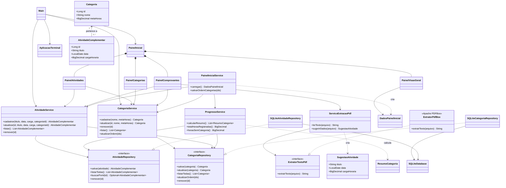

# Arquitetura do sistema

## Padrões aplicados

- **Responsabilidade única (SRP):** `CategoriaService` concentra as operações de categoria, `AtividadeService` concentra as operações de atividade e `ProgressoService` calcula os resumos. `ServicoExtracaoPdf` interpreta o texto dos PDFs.
- **Repository:** `CategoriaService` usa `CategoriaRepository`, enquanto `AtividadeService` usa `AtividadeRepository` e `CategoriaRepository`. `SQLiteCategoriaRepository` e `SQLiteAtividadeRepository` implementam as interfaces e compartilham `SQLiteDatabase`.
- **Strategy:** `ServicoExtracaoPdf` depende da interface `ExtratorTextoPdf`, implementada por `ExtratorPdfBox`. Assim, o serviço não fica acoplado diretamente à biblioteca de leitura de PDF.

## Fluxo resumido

1. `PainelInicial` reúne os painéis de visão geral, atividades, categorias e comprovantes.
2. Cada painel encaminha as ações do usuário aos serviços de aplicação correspondentes.
3. `CategoriaService`, `AtividadeService` e `PainelInicialService` validam e coordenam as operações.
4. Os serviços usam os repositórios para salvar ou consultar dados; `ProgressoService` calcula os resumos por categoria.
5. Ao selecionar um PDF, `ServicoExtracaoPdf` usa `ExtratorTextoPdf`, implementada por `ExtratorPdfBox`, e cria uma `SugestaoAtividade`.
6. Os campos sugeridos podem ser conferidos e alterados antes de `AtividadeService` cadastrar a atividade. O PDF pode ser copiado ou aberto localmente, mas não fica associado permanentemente à atividade no banco.

As categorias e metas são configuradas pelo estudante. A extração do PDF não define a categoria nem determina se uma atividade será aceita pela coordenação.
